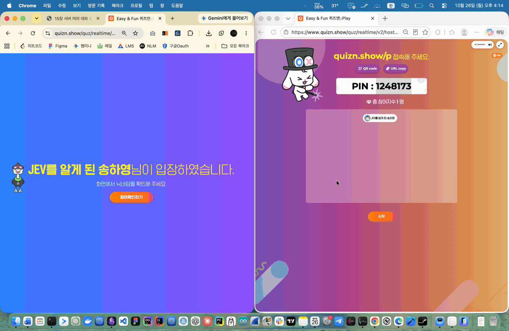
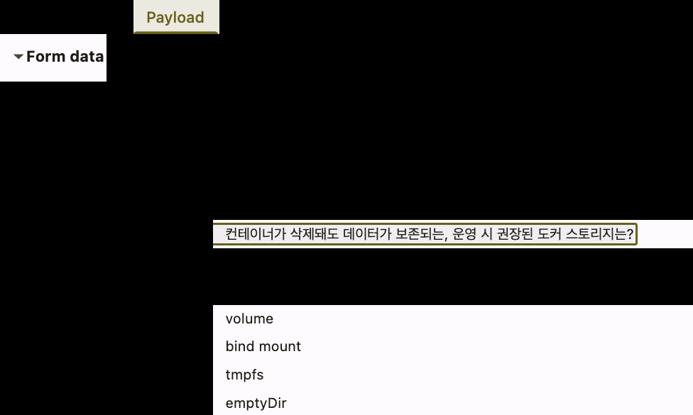
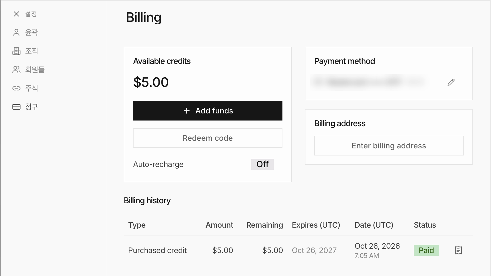

# 이건 JEV를 알게 된 송하영이 클라우드네이티브와운영기술 퀴즈 1등이 되기까지의 이야기이다.

실시간 퀴즈를 자동으로 푸는 크롬 확장 프로그램입니다. 문제가 뜨면 0.2초 안팎에 정답 버튼을 누릅니다.

실제 퀴즈에서 다섯 문제 중 네 문제는 0.2초, 마지막 문제는 0.5초 만에 답했습니다.

## 문제

수업에서 쓰는 실시간 퀴즈 서비스 퀴즈앤(quizn.show)은 참가자 화면에 보기 버튼 네 개만 보여 주고 문제 글은 교수님 화면에만 띄웁니다. 문제를 풀려면 먼저 문제를 알아야 하는데 제 화면에서는 문제를 볼 수 없었습니다.

## 가장 먼저 든 생각

제 화면도 보기 버튼을 그리려면 어딘가에서 문제 정보를 받아 올 것이라고 생각해 퀴즈를 하는 동안 개발자 도구의 Network 탭을 HAR 파일로 저장해 분석했습니다. 교수님이 다음 문제로 넘기면 서버가 웹소켓으로 신호를 보내고, 참가자 페이지는 이 신호를 받아 보기 화면을 그리기 위한 API를 호출합니다.

이 API 요청 본문에 문제와 보기 네 개가 평문으로 들어 있었고, 화면에서는 표시 여부를 정하는 값 하나로 문제만 숨기고 있었습니다. 다만 정답은 요청에 들어 있지 않고 채점은 서버에서 하므로 정답은 직접 풀어야 했습니다.

## 구현

이 요청을 가로채는 크롬 확장 프로그램을 만들었습니다. 페이지 컨텍스트에 주입한 스크립트가 `XMLHttpRequest`를 감싸 해당 API 요청이 나가는 순간 본문에서 문제와 보기를 꺼내고, 백그라운드 서비스 워커가 제미나이에게 정답 번호만 답하게 합니다. 번호가 오면 화면의 해당 보기 버튼을 클릭하는데, 이 퀴즈는 보기를 누르면 바로 제출되므로 클릭 한 번으로 끝납니다.

## 추가 문제

실제 퀴즈에서 전부 맞혔지만 답이 오기까지 1초 정도 걸렸습니다. 제미나이 같은 언어 모델은 답을 글자 단위로 생성하기 때문에 숫자 하나를 받는 데도 이만큼 시간이 들고, 퀴즈앤은 빨리 답할수록 점수가 높아 1등을 하려면 1초도 길었습니다.

## JEV

그래서 결정 모델인 Jev를 쓰기로 했습니다. Jev는 글을 생성하지 않고 보기마다 확률을 한 번에 계산해 하나를 고르기 때문에 응답이 훨씬 빠릅니다. 최소 결제 금액인 5달러를 충전했는데, 한 문제에 0.01원 정도라 5달러로 수십만 문제를 풀 수 있습니다.

## 해결

Jev 공식 문서에는 한국어 같은 언어는 성능을 따로 확인하라고 적혀 있어서 Jev 하나만 믿기는 불안했습니다. 그래서 문제가 오면 Jev와 제미나이에게 동시에 묻고, Jev가 고른 보기의 확률이 0.7 이상이면 바로 누르고 그보다 낮으면 제미나이의 답을 기다리도록 했습니다. Jev가 확신하는 대부분의 문제는 0.2초 안팎에 끝나고, 애매한 문제도 예전처럼 1초 정도면 풀립니다.

| 방식 | 강의자료 문제 정답 | 걸린 시간 |
|---|---|---|
| 제미나이만 사용 | 15문제 중 15문제 | 약 1.1초 |
| Jev와 제미나이 동시 사용 | 17문제 중 17문제 | 약 0.2초 |

## 설치

1. `extension/config.example.js`를 `extension/config.js`로 복사하고 Google AI 키와 TypeSafe 키를 넣습니다.
2. 크롬 `chrome://extensions`에서 개발자 모드를 켜고 `extension` 폴더를 압축해제된 확장 프로그램으로 불러옵니다.
3. 퀴즈앤 참가 화면을 새로고침한 뒤 PIN으로 들어가면 문제가 뜰 때마다 알아서 답을 누릅니다.
